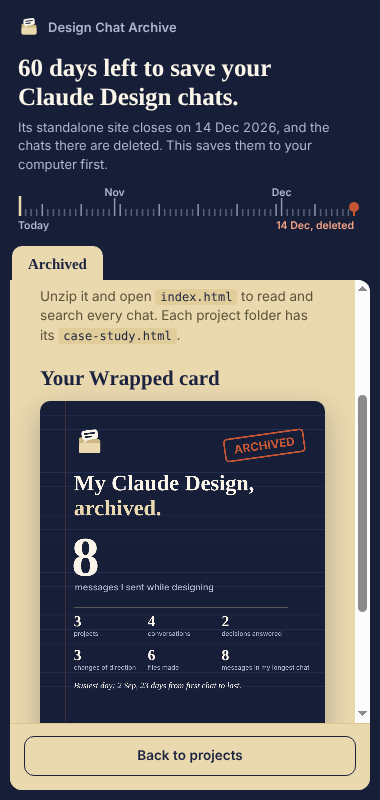
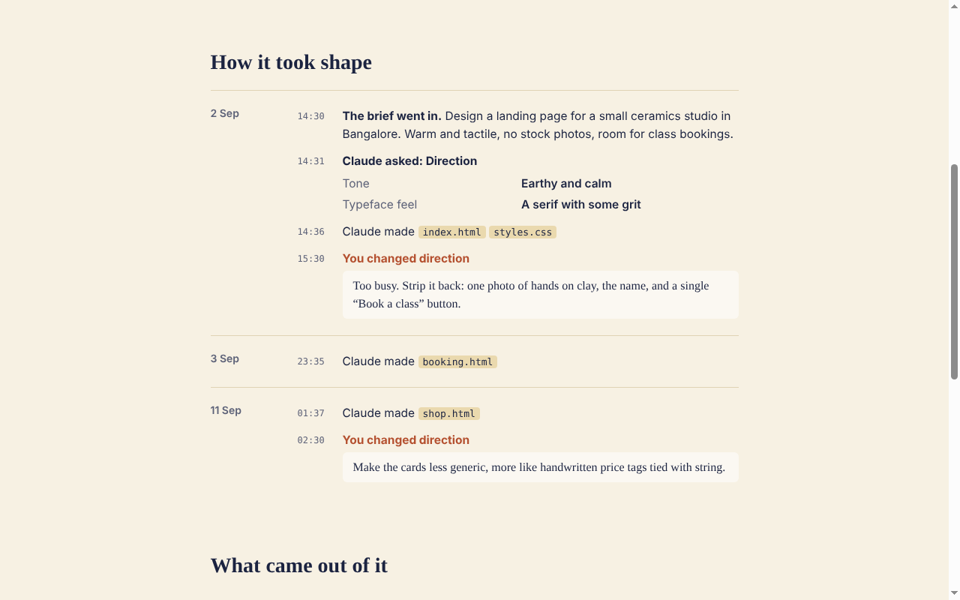
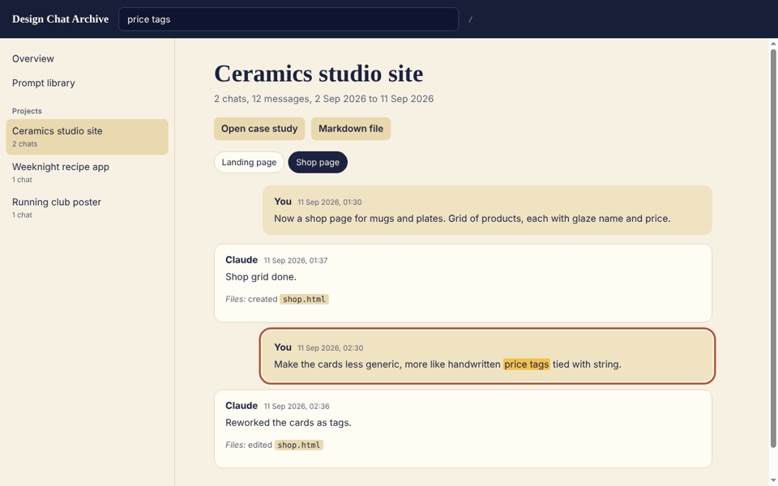

# Design Chat Archive

Save your Claude Design chats before they're deleted, and keep the story of how each design took shape.

The standalone Claude Design site (claude.ai/design) closes on **14 December 2026**. You can still download your projects, but **your chats are not migrated**: they are deleted after the closure. This Chrome extension saves every conversation from every project. It also turns those chats into things a designer can use: a case study for each project, a searchable offline reader, a library of the prompts that worked, and a card to share.

This tool is unofficial. It is not made by or affiliated with Anthropic.

<p>
  
  
</p>

**[Add to Chrome](https://chromewebstore.google.com/detail/lihmgpeogngjlfiiopmanigholpejlei)** · [What you get](#what-you-get) · [Privacy](#privacy-and-security) · [Privacy policy](PRIVACY.md)

## Use

1. Open [claude.ai/design](https://claude.ai/design) while signed in.
2. Click the extension's icon in Chrome's toolbar. If you can't see it, pin it from the puzzle-piece menu. The side panel opens and lists your projects. It also shows how many days are left before the deadline.
3. Choose your projects and what to include, then click **Archive**. One ZIP lands in your Downloads.

To save just the project you're in, use the **Save chats** button next to **Share** in the project's toolbar. It saves that project's chats, its case study and a reader.

## What you get

```
claude-design-chats-2026-10-15/
  index.html                        start here: every chat, searchable, works offline
  prompts.md                        every prompt you wrote; the ones that led to work you kept are marked
  wrapped.png                       your Claude Design in numbers, to share (never shows project names)
  README.md                         every project, with chat and message counts
  Ceramics studio site/
    case-study.html                 a first draft of the project's story
    _index.md                       the project's chats in order, with dates
    01 Landing page (2026-09-02).md one readable transcript per chat
    _resume-in-claude.md            how to continue this project in Claude, with a ready prompt
    _raw/project-data.json          the complete original data (optional, off by default)
```

**Transcripts** keep the full back-and-forth in order:

- your messages and Claude's replies, with timestamps
- the questions Claude asked you, with their options, and the answers you picked
- the steps Claude took in each turn, and the files each turn created or edited

**The case study** is what sets this apart. For each project it drafts:

- the brief
- every question Claude asked and what you answered
- the moments you changed direction
- the files that came out of it
- the prompts that worked

It's a plain HTML page you can edit into a portfolio piece. "Changes of direction" and "prompts that worked" are worked out from wording and file changes, so check them before you publish.

<p></p>

**The offline reader** (`index.html`) shows every chat, with search across all of them. It needs no internet and makes no network requests.

<p></p>

Claude's internal thinking is left out of everything except the optional raw JSON. Your design files are **not** included. Download those per project from Claude Design: Share → Project HTML → Project archive.

## Install

**[Install from the Chrome Web Store](https://chromewebstore.google.com/detail/lihmgpeogngjlfiiopmanigholpejlei)**. Updates arrive automatically.

**Or load it from GitHub:** download the [latest release](https://github.com/jeshwanthshivasai/claude-design-chat-archive/releases/latest), unzip it, and keep that folder. Then open `chrome://extensions`, turn on **Developer mode**, click **Load unpacked**, and pick the folder that contains `manifest.json`. You'll need Chrome 116 or later. Other Chromium browsers should work but haven't been tested.

## How it works

There is no server and no account. When you open the side panel on a Claude Design tab, it talks over a private channel to the extension's script running in that tab. That script asks the site for your projects using the requests the Claude Design page itself makes:

- `ListProjects`
- `ListOrgProjects`, for projects shared in a team
- `GetProject`

These requests use the session you're already signed in with. The script then writes the Markdown, case studies and reader, builds the ZIP in memory, and hands it to Chrome as a download.

| File | What it does |
|---|---|
| `sidepanel/` | the side panel |
| `src/bridge.js` | connects the panel to the tab; one export at a time |
| `src/savebtn.js` | the Save chats button and its notice |
| `src/exporter.js` | the three requests, retries, Stop, the sharing rule |
| `src/render.js` | project data → Markdown |
| `src/insights.js` | the brief, decisions, changes of direction, prompts and numbers |
| `src/casestudy.js`, `src/viewer.js`, `src/wrapped.js` | the case study, the offline reader, the card |
| `src/pipeline.js` | runs an export from start to finish |
| `src/zip.js` | the ZIP file, written from scratch so there's no third-party code to trust |

## Privacy and security

- **Runs entirely in your browser**, using your existing Claude sign-in. It never sees your password; Chrome attaches the session to the requests, as it does for the page itself.
- **Sends nothing anywhere.** The only network requests go to `claude.ai`, the site you're already on. There are no servers, analytics, third-party code, remote scripts or remote fonts.
- **Stores almost nothing.** The side panel remembers your six option switches in this browser. No project names, chats or IDs are kept.
- **Permissions:** `sidePanel`, plus a script that runs only on `claude.ai/design` pages. Chrome describes that script as being able to "read and change your data on claude.ai", because any extension that runs a script on a site gets that label.
- **Read-only.** It only makes the three requests above. It never sends a message, edits a project or changes a setting.
- **Shared projects (Team and Enterprise):** a project's chats are saved only when the server says the project is yours or says its owner shared the chats with you. Otherwise nothing from that project is saved. Where several people wrote in a chat, only your own messages count as yours in the case study, the prompt library and the card.
- **The generated pages are safe to open:**
  - Everything quoted from a chat is escaped.
  - The case study runs no script.
  - The reader's only script is its own, embedded in the file, and it only follows `http(s)` links.
  - Hidden characters are stripped from prompts before you can copy them back into Claude.
- **The page can see the download.** The ZIP is downloaded from your Claude Design tab, so claude.ai's own page can notice that it happened. That page is where the data came from in the first place.
- **What the archive contains, so you can decide where to keep it:**
  - everything said in your chats, including client material, uploaded text and any local file paths you gave Claude
  - the display names of people who wrote in shared chats
  - with raw data switched on: every tool call and file edit, with file contents
- **Terms of service:**
  - Anthropic's consumer terms restrict access by automated means.
  - Its support article on the closure tells you to save what you need from your chats.
  - This is a user-initiated export of your own data, not an Anthropic-approved tool. Use your judgement.

`node test/run.js` runs the unit tests (no network, no browser). `node test/e2e.js` runs the real extension in Chromium against a fake Claude Design.

## If something goes wrong

- **The panel says "Open Claude Design to begin" while you're on it:** reload the tab once after installing or updating. The extension connects when the page loads.
- **"Your Claude session may have expired"** or **"not signed in":** reload Claude Design, sign in if asked, and try again.
- **A project failed:** its folder contains `_error.txt` with the reason. If the data arrived but couldn't be turned into Markdown, `_raw/project-data.json` is kept, so nothing is lost.
- **An extra is missing:** `_extras-error.txt` at the top of the ZIP says why. The transcripts are complete either way. Very large archives skip the single-page reader; archive fewer projects at a time to get it.
- **The second ZIP didn't download:** Chrome may be asking whether claude.ai can download multiple files. Choose **Allow**.

This relies on Claude Design's internal web requests, which are undocumented and may change without notice. It's a rescue tool for before the closure date, not a long-term integration.

## License

MIT
