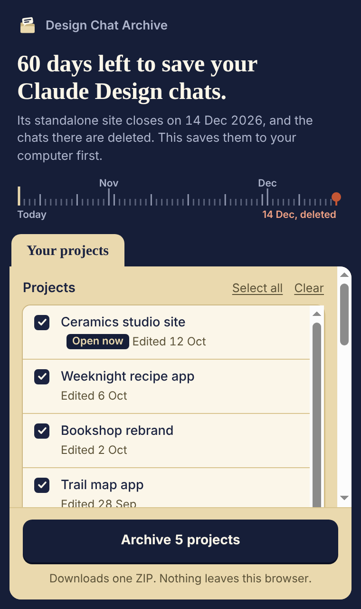
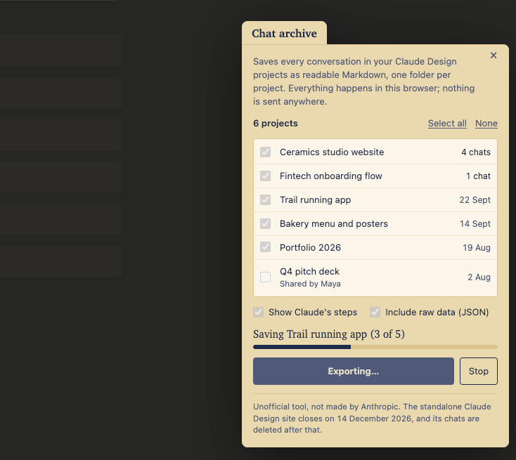

# Chat Archive for Claude Design

The standalone Claude Design site (claude.ai/design) closes on **14 December 2026**. Your projects can be downloaded, but **your chats are not migrated** and are deleted after the closure. This Chrome extension saves every conversation from every project in one click, as readable Markdown plus the complete raw data.

Unofficial. Not made by or affiliated with Anthropic.

<p>
  
  
</p>

**[Download the latest release](https://github.com/jeshwanthshivasai/claude-design-chat-archive/releases/latest)** · [Install](#install-about-one-minute) · [How it works](#how-it-works) · [Privacy](#privacy-and-security)

## What you get

One ZIP with a folder per project:

```
claude-design-chats-2026-10-12/
  README.md                         every project, with chat and message counts
  GenbaNEXT Website/
    _index.md                       the project's chats in order, with dates
    01 Homepage redesign (2026-05-04).md
    02 Mobile pass (2026-05-09).md
    _resume-in-claude.md            how to continue this project in Claude, with a ready prompt
    _raw/project-data.json          the complete original data (optional)
```

Each transcript keeps the full back-and-forth in order:

- your messages and Claude's replies, with timestamps
- the questions Claude asked you, with their options, and the answers you picked. Much of the steering usually happens here.
- the steps Claude took in each turn (files written, edits, checks) as compact lists, plus which files each turn created or edited
- messages you sent mid-turn, errors, and the todo list at the time of export

Claude's internal thinking is left out of the Markdown. It is in the raw JSON, where present.

Your design files are **not** included. Download those per project from Claude Design: Share → Project HTML → Project archive.

## Install (about one minute)

1. Open the [latest release](https://github.com/jeshwanthshivasai/claude-design-chat-archive/releases/latest), download **Source code (zip)** under Assets, and unzip it somewhere you'll keep it. Chrome loads the extension from that folder, so don't delete it afterwards.
2. In Chrome, open `chrome://extensions`.
3. Turn on **Developer mode** (top right).
4. Click **Load unpacked** and select the unzipped folder (the one containing `manifest.json`).

Chrome shows a "Disable developer mode extensions" bubble on startup while any unpacked extension is installed. That's expected. Once your ZIP is safely saved, you can remove the extension from `chrome://extensions`.

Works in Chrome and other Chromium browsers (Edge, Brave, Arc, Vivaldi) via the same steps. Firefox is untested.

## Use

1. Open [claude.ai/design](https://claude.ai/design) while signed in.
2. Click the **Export chats** tab on the right edge of the page.
3. Untick any projects you don't want, then click **Export**.

A project with a few chats takes about a second; a chat with 1,000 messages takes a couple of seconds. You can keep working in other tabs while it runs, and **Stop** ends the export at once with a ZIP of what's finished.

## How it works

There is no server, no account and no install beyond your own Chrome. Chrome runs the extension's script inside your Claude Design tab, in its own sandbox (an "isolated world") that the page's scripts can't see or alter. When you click **Export**, that script asks the site for your project list and each project's data using the same three internal requests the Claude Design page itself makes when it loads (`ListProjects`, `ListOrgProjects`, `GetProject`), authenticated by the session you're already signed in with. The reply contains the chats. The script turns them into Markdown, builds the ZIP in memory, and hands it to Chrome as a normal download. Nothing is sent anywhere and nothing is kept once the tab closes.

Everything above is the user-visible version of `src/`:

| File | What it does | Lines |
|---|---|---|
| `src/exporter.js` | the three requests, retries, Stop | ~190 |
| `src/render.js` | project data → Markdown | ~390 |
| `src/zip.js` | the ZIP file, written from scratch so there's no third-party code to trust | ~110 |
| `src/panel.js` | the panel on the page | ~270 |

## Privacy and security

- **Runs entirely in your browser**, using your existing Claude sign-in. It never sees your password or cookies; Chrome attaches the session to the requests, as it does for the page itself.
- **Sends nothing anywhere.** The only network requests go to `claude.ai`, the site you're already on. No servers, no analytics, no crash reporting, no third-party code, no remote scripts.
- **Stores nothing.** No settings, no cache, no browser storage. Close the tab and it's gone.
- **No permissions in the manifest.** Chrome will still describe it as able to "read and change your data on claude.ai", because any extension that runs a script on a site gets that label. It runs only on `claude.ai/design` pages.
- **Read-only.** It only makes the three requests above. It never sends a message, edits a project or changes a setting.
- **Shared projects (Team and Enterprise):** projects teammates shared with you are listed but unticked by default. If the owner has not shared the chats with you, the extension exports none of that project's chats, whatever the server sends back.
- **What the archive contains, so you can decide where to keep it:** the Markdown holds everything said in your chats, including client material, uploaded text and any local file paths you gave Claude. The optional raw JSON holds the complete project data as Claude Design stores it: every message, tool call and file edit (with file contents), Claude's thinking where present, unsent drafts, and internal IDs. Times are shown in your local time with its UTC offset. Treat the ZIP as private.
- **Transcripts are plain Markdown** and keep any HTML that appeared in the chat. Open them in a text or Markdown editor rather than a web browser.
- **Terms of service.** Anthropic's consumer terms restrict accessing its services through scripts or by automated means, and its support article on the closure tells you to save anything you need from your chats before the site closes. This is a user-initiated export of your own data, which Anthropic's terms say you own, but it is not an Anthropic-approved tool. Use your own judgement.

The code is small enough to read in a few minutes, and `node test/run.js` runs the regression tests (no network, no browser).

## If something goes wrong

- **"Your Claude session may have expired"** or **"not signed in"**: reload Claude Design, sign in if asked, and try again.
- **A project failed**: its folder in the ZIP contains `_error.txt` with the reason. If the data was received but couldn't be turned into Markdown, the folder also contains `_raw/project-data.json`, so nothing is lost. The rest of the export still completes.
- **No tab on the page**: reload the page after installing. The extension only runs on claude.ai/design, not on the main Claude site.
- **Couldn't load your projects**: close and reopen the panel to retry.

This relies on Claude Design's internal web requests, which are undocumented and may change without notice. It is meant as a one-off rescue tool before the closure date, not a long-term integration.

## License

MIT
